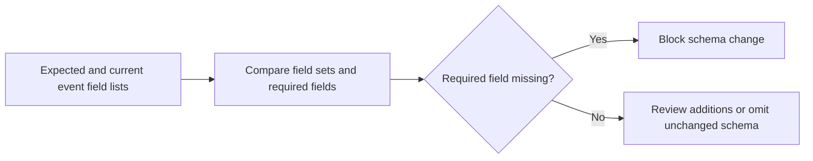

# Stream Schema Drift Watch

Compares current event schemas against expected contracts and flags drift before AI features break.

Focus: Kafka streams, schema drift, ML feature reliability, SRE.

Portfolio framing: Apple-scale client-style platform project using synthetic data only.

## Run

```bash
python3 schema_drift_watch.py sample_schemas.csv
```

## Verify

```bash
python3 -m unittest discover . -v
```

## Local verification

Run `make verify` with Make and Python 3 installed. The target runs the documented sample through the project CLI. It also runs the existing Python unit tests.

## Project walkthrough



[Architecture and data flow](docs/ARCHITECTURE.md) · [Business problem, demo, and verification](docs/CASE_STUDY.md)
