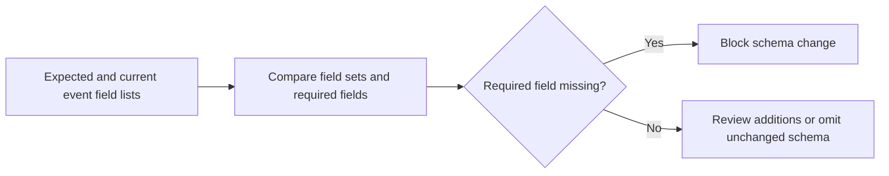

# Stream Schema Drift Watch architecture

Compares current event schemas against expected contracts and flags drift before AI features break.

## Operational boundaries

The documented run evaluates the bundled sample locally. Results depend on the quality and scope of the input. The demo makes no live infrastructure changes.
